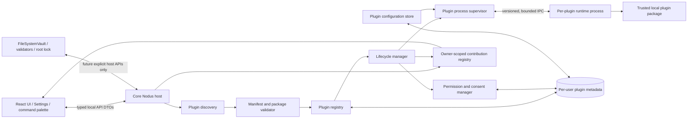

# Phase 30A — Plugin Architecture Audit and Technical Design

**Status:** Historical architecture proposal/audit (current workstream identifier P0). The title's “Phase 30A” is a historical internal label, not an official roadmap milestone. Official Phase 30 is Conflict Resolution; Plugin Architecture is tracked separately as P0–P8. No plugin runtime is implemented.

**Scope:** Repository investigation and design only. This document does not authorize plugin execution, change the application API, or change the official roadmap.

## 1. Executive summary

Nodus has useful extension *surfaces*, but no plugin subsystem: the command palette and sidebar are assembled by the React application, Settings is a composed React view, database views are validated persisted configurations, automations are a constrained first-party workflow feature, and the local API routes directly call storage services. There is no plugin registry, package loader, lifecycle manager, capability broker, plugin persistence contract, or plugin-specific IPC.

The current application is a web UI hosted by Vite's Node server and its local API middleware. It is not an Electron/Tauri application with a distinct desktop main process. A design that assumes an existing main-process/renderer IPC boundary would therefore add a new runtime rather than reuse one.

**Historical P0 proposal, superseded by the owner-approved P2 decision:** make a versioned, schema-validated host API the only supported integration contract, and keep the UI, registry, persistence, permissions, and lifecycle in the existing Nodus host. For executable plugins, this audit proposed a separately launched per-plugin process with a narrow, versioned, bounded IPC protocol over importing plugin modules into Nodus. It also proposed treating installed code as trusted local software in a first release. These are historical proposals only: P2 defers executable plugins, approves no runtime or execution model, and retains separate-process execution only as a future evaluation option. The P0 security cautions remain: ordinary process separation, API restrictions, a Node `vm`, and worker threads are not OS security sandboxes and do not prevent direct access to resources available to the local user.

Start with command and declarative sidebar contributions. Keep workspace, database, filesystem, network, editor, and arbitrary React/UI access out of API v1. Every host registration must be owned by a plugin and removed on disable, failure, or uninstall. Store packages and plugin state in per-user application data, outside the vault. Do not fetch or execute remote code automatically.

The repository contains untracked `docs/plugin-architecture.md`, `docs/plugin-api.md`, `docs/plugin-security.md`, and `docs/plugin-development.md`. They are local design material, not runtime evidence or canonical Phase 30 acceptance. This audit is the requested Phase 30A deliverable; those files and all other existing work are left unchanged.

## 2. Existing architecture findings

### Application and UI boundary

- `ui/src/main.tsx` mounts the React application in the Vite UI. `ui/src/App.tsx` owns the workspace shell, current view/navigation state, data loading, and composition of the sidebar, command palette, and Settings.
- `ui/vite.config.ts` attaches `createLocalApiMiddleware` from `src/ui-server/api.ts` to the Vite dev and preview servers. The browser calls a loopback HTTP API (`ui/src/api.ts`); it does not import Node storage implementations. There is no Electron/Tauri host, IPC framework, or dedicated application main process in the current runtime.
- `src/ui-server/dto.ts` is the shared typed wire-contract layer. `src/ui-server/api.ts` performs request parsing, local-origin checks, route dispatch, storage calls, and response serialization. New extension traffic should have explicit DTOs and routes rather than handing plugins `IncomingMessage`, `ServerResponse`, a vault instance, or service objects.
- `src/index.ts` is the package's public library barrel. It currently exports application/domain capabilities, not a versioned plugin API. Future plugin authors should consume a dedicated stable API package or documented entry point, not import arbitrary `src/**` files.

### Existing extension surfaces

- **Commands:** `ui/src/commands.ts` has pure command identity, deduplication, ranking, grouping, and error-normalization helpers. The actual command objects and actions are created by `ui/src/App.tsx` and rendered by the command palette. There is no runtime registration service or owner cleanup.
- **Sidebar:** `ui/src/Sidebar.tsx` renders the fixed application navigation and current workspace actions. It does not consume third-party contribution descriptors.
- **Settings:** `ui/src/SettingsView.tsx` composes local vault, appearance, workspace customization, backup/restore, and sync-status sections using shared shadcn/ui primitives. This is the natural discovery point for a future Plugins section, not a separate settings framework.
- **Database views:** `src/database/database-view.ts` and related validation/serialization code define portable, versioned saved views; `ui/src/DatabaseLayouts.tsx` renders supported layouts. These are user data and query configurations, not a dynamic view-component registry. Letting plugins provide arbitrary view code would require a stable render/query contract and a stronger runtime boundary.
- **Automations and events:** `src/database/automations.ts`, its storage/API routes, and `ui/src/DatabaseAutomations.tsx` implement constrained database triggers and actions. This is not a general application event bus or plugin subscription mechanism. Automation actions use existing validation and write paths; plugins must not receive internal event emitters or bypass those paths.
- **Editor:** `ui/src/editor/CodeMirrorEditor.tsx` composes CodeMirror extensions and host editor behavior. There is no stable plugin editor extension contract. Exposing raw CodeMirror extensions would couple third parties to the editor and run arbitrary code in the renderer.

### Storage, locking, and recovery

- `src/storage/contracts.ts` defines filesystem-independent storage contracts. `src/storage/fs/vault.ts` implements `FileSystemVault` and owns validated note/database operations. `src/storage/fs/root-lock.ts` serializes cooperating vault writers. This lock is vault-scoped and is not a general plugin registry lock.
- `src/storage/fs/atomic.ts` provides atomic sibling-file replacement, used by vault and application-preference writes. `src/ui-server/app-preferences.ts` places per-user preferences under the platform application-data directory and writes atomically. Its current read/modify/write behavior is not itself a cross-process transaction for a future shared plugin registry.
- Portable import/export, backup/restore, integrity manifests, and import recovery live in storage services and UI/API boundaries (`src/storage/portable/`, `src/storage/fs/vault.ts`, `src/ui-server/api.ts`, `ui/src/BackupRestoreSection.tsx`). A plugin system must not reuse import execution as an implicit plugin installer or weaken its source, destination, locking, or recovery checks.
- The vault is the source of truth for Markdown and structured workspace data. Plugin code, grants, enablement, and configuration should live outside it so export/import, vault switching, and recovery remain independent of plugins.

### Current source-of-truth distinction

At the time this audit was written, verified implementation paths contained no plugin manager, manifest validator, runtime, permission store, contribution registry, or Plugins UI. The original active-roadmap interpretation in this historical section is superseded by the dated correction below and by P2.

**Historical correction — 2026-11-06:** Official Phase 30 is Conflict Resolution. Plugin Architecture is the independent P0–P8 workstream and does not occupy official Phase 22 or Phase 30. The old “30A–30G” labels in this proposal are internal historical work-package labels, not official phase numbers; a qualified crosswalk is recorded in [the current plugin workstream roadmap](plugin-workstream-roadmap.md). P1 subsequently implemented metadata-only manifest validation, discovery, fingerprinting, dependency checks, and an in-memory registry. P1 does not install, activate, persist, grant permissions, or execute entrypoints. P2 supersedes this document's earlier executable-plugin and trusted-process proposals: execution remains deferred, and no runtime is approved.

## 3. Current extension opportunities

| Surface | Existing host capability | Reuse opportunity | Boundary required before third-party use |
|---|---|---|---|
| Commands | Pure palette helpers and host-owned action definitions | Feed validated descriptors into existing search/group/render logic | Owner-qualified IDs, plain-text metadata, host-invoked execution, cleanup handle, bounded result |
| Sidebar | Host-rendered navigation in `Sidebar.tsx` | Render declarative links/actions alongside host sections | No plugin React component; contribution invokes an owned command; host controls accessibility and navigation |
| Settings | Composed Settings sections and shadcn/ui primitives | Add host-rendered plugin list/details in Settings | Do not accept plugin-supplied React pages in v1 |
| Context menus | Shared menu primitives and domain-specific menus | Add declarative action descriptors after menu ownership contracts are clear | Must define target types, selection snapshots, keyboard behavior, and stale-target handling |
| Application events | Specific storage and automation workflows, no generic bus | A future allow-listed event DTO layer | Event schema/version, payload minimization, backpressure, unsubscribe/disposal, no raw notes by default |
| Editor extensions | CodeMirror 6 host integration | Potential later curated extension protocol | Raw `Extension` values are code execution and a version-sensitive renderer coupling |
| Database integration/property types | Typed schema, validation, projection, and row write services | Future host-mediated property adapter contract | Requires schema serialization, query/sort/filter/backup/import/export semantics, migration and dependency rules |
| Custom database views | Saved-view configuration plus fixed layouts | Maybe declarative view configuration later | Arbitrary view code needs a UI/runtime protocol and must preserve saved-view compatibility; not suitable for v1 |

**Minimal API v1 recommendation:** register commands and declarative sidebar items that point to commands. These integrate with existing host-owned UI and do not require plugins to read or write workspace content. Plugin commands should receive only bounded, versioned invocation arguments and return a bounded plain-text result or a structured error. No workspace or database API should be implied by being visible in a command.

## 4. Execution architecture comparison

**Historical comparison, not an approved execution decision:** The options and recommendations in this section were written before the owner-approved P2 decision. P2 supersedes any recommendation below that would execute plugins; executable support remains deferred and no model is approved.

Nodus does not currently have a separate desktop main process, so “main-process plugin” below means code loaded into the Node local-API host process.

| Model | Security boundary and failure behavior | Performance and lifecycle | Offline and Nodus fit | Assessment |
|---|---|---|---|---|
| Renderer module | Same-origin module code can access the DOM, mutate UI state, call reachable localhost APIs, and use browser network/storage capabilities. Not isolated from the app renderer. | Low startup/IPC cost; can freeze or crash the UI; teardown must clean browser resources. | Offline-compatible, but couples plugins to React/Vite and the browser bundle. | Reject as the execution model. Keep only host-rendered declarative contributions in the renderer. |
| Node host/main-process module | Same process and user privileges; can import Node built-ins and internal modules, read/write user-accessible files, make network requests, consume resources, or terminate the host. A narrow object is not enforcement. | Lowest IPC cost; lifecycle is simple until plugin faults affect all Nodus services. | Compatible with current Vite middleware, but creates an especially risky coupling to server internals. | Reject for execution. Useful only for trusted first-party code, not a plugin boundary. |
| Worker thread | Separate JS isolate/thread can improve responsiveness and allow termination, but remains in the same OS process and does not provide a security boundary over Node capabilities. | Moderate messaging and lifecycle cost; memory/process failures can still affect host. | Local and offline; adds worker build/runtime complexity. | Not sufficient as the security or fault boundary. |
| VM/context sandbox | Language-level context can hide selected globals, but is not a robust boundary against hostile code, native modules, runtime escapes, or resource abuse. | Low IPC cost; difficult to make lifecycle and compatibility dependable. | Local, but security claims would be misleading. | Reject as a security sandbox. |
| Sandboxed isolated runtime | Browser/OS sandbox can restrict capabilities if correctly configured, with host-mediated IPC. | More packaging, policy, testing, and platform work; clean process lifecycle and crash containment. | Can be offline; cross-platform enforcement is the main complexity. | Long-term target if untrusted community plugins are required. Must prove enforcement per supported OS before claiming isolation. |
| External process with typed IPC | Process boundary hides Nodus object graph and contains ordinary crashes, but without OS sandbox it still runs with the user's filesystem/network permissions and may interfere with the parent process. | Higher startup and serialization overhead; straightforward process exit/restart/timeout supervision. | Fits a local Node host and offline use; requires a protocol and process manager. | Recommended initial execution boundary for **trusted local plugins**, with explicit non-sandbox disclosure. Add OS sandboxing only after enforceable cross-platform design and tests. |

### Recommended security statement

The original P0 proposal described a first execution version as **trusted local plugin code running in a separate process with limited host IPC**. That recommendation is superseded by P2 and is not approved. The accompanying analysis remains relevant if execution is reconsidered: an ordinary process may isolate some accidental coupling and process failures, but it does **not** prevent code from using the local user's OS permissions, reading accessible files, accessing the network, consuming resources, or attempting to interfere with Nodus. API permissions do not constrain direct OS calls, and this arrangement is not a secure sandbox. No plugin execution is authorized unless a future owner decision approves a host and security model.

## 5. Recommended architecture and component responsibilities



The UI communicates only with the host through typed DTOs. The host owns package paths, registry state, permission decisions, lifecycle state, and contribution validation. Plugin code runs in a supervised process and receives only a versioned IPC capability facade. In the initial API, the host should not expose workspace methods at all. Future workspace operations must be host-mediated calls into existing validated storage services and lock/revision contracts.

| Component | Responsibility and boundary |
|---|---|
| Manifest | Declarative package identity, compatibility, entrypoint, requested capabilities, dependencies, and optional configuration/UI declarations. No executable permission is inferred from metadata. |
| Discovery | Enumerates only the configured plugin root, rejects links/non-regular files and path escapes, applies resource limits, and returns candidate package locations. It does not execute code. |
| Validator | Parses untrusted manifest bytes; validates format/schema, ID, paths, versions, capabilities, package inventory, entrypoint and dependency graph. Produces structured diagnostics. It must finish before process launch. |
| Registry | Combines validated package metadata with installed/enabled state, fingerprint, and validation diagnostics. Enforces duplicate stable IDs and deterministic ordering. |
| Lifecycle manager | Owns legal transitions, single activation, dependency order, startup/shutdown, disable/uninstall, fault isolation, and disposal. It is the only component allowed to start or stop a plugin process. |
| Runtime/process supervisor | Starts one plugin process with restricted environment and stdio IPC, validates protocol frames, applies message/timeout/size limits, observes exit, and terminates on disable or shutdown. Process separation is not equivalent to OS sandboxing. |
| Permission manager | Intersects manifest requests with supported API capabilities and explicit per-user grants. Denies by default, reports revocation, and binds grants to package identity/fingerprint. Unsupported capabilities cannot be approved. |
| Public extension API | Stable, independently versioned DTO/protocol contract. Contains no Node, React, filesystem path, vault, database, HTTP server, or internal store types. |
| Contribution registry | Stores validated contributions by `{ownerPluginId, localId}`; rejects collisions, validates command references, returns opaque handles, and removes all owner entries on disable/failure/uninstall. |
| Configuration store | Persists per-plugin user settings separately from plugin files. Validates values against the bounded supported schema subset and preserves values across disablement. |
| Plugin management interface | Settings section listing installed plugin identity, compatibility, lifecycle, capabilities, diagnostics, enable/disable, details, and confirmed uninstall. UI renders host-owned DTOs only. |

### Communication flow

1. At startup or explicit refresh, discovery returns package candidates without evaluating code.
2. Validator checks each manifest/package. Registry rejects duplicate IDs and computes dependency order; invalid plugins remain visible with diagnostics.
3. The lifecycle manager reads persistent enablement and consent. Disabled packages are never launched.
4. For an enabled package whose fingerprint/grants still match, permission manager builds the allowed API set. Any changed package requires review and fresh consent before activation.
5. Supervisor launches the process and performs protocol/API-version handshake. The plugin registers contributions through IPC. Host validates and records every contribution under its owner.
6. The UI receives serializable contribution DTOs. An invocation is checked against owner, command, active state, declared and granted capability, schema, and limits before forwarding to the process.
7. Disable/failure/uninstall removes contributions, requests plugin shutdown, then terminates the process and reclaims host resources. Cleanup is idempotent and best effort.

## 6. Plugin manifest specification proposal

Manifest filename: `nodus-plugin.json`. Manifest format and plugin API versions are independent from note, database, saved-view, backup, portable export, and application preference versions.

```json
{
  "format": "nodus-plugin",
  "formatVersion": 1,
  "id": "io.example.reading-tools",
  "name": "Reading Tools",
  "version": "1.2.0",
  "description": "Adds a command for opening a reading list.",
  "author": "Example Studio",
  "minNodusVersion": "0.1.0",
  "pluginApiVersion": 1,
  "entryPoint": "dist/plugin.mjs",
  "capabilities": ["commands.register", "sidebar.register"],
  "dependencies": [
    { "id": "io.example.shared", "range": "^1.0.0", "optional": false }
  ],
  "configSchema": {
    "type": "object",
    "properties": {
      "listName": { "type": "string", "default": "Reading" }
    },
    "required": [],
    "additionalProperties": false
  },
  "uiContributions": ["command", "sidebar"]
}
```

### Field and validation rules

- `format`, `formatVersion`, `id`, `name`, `version`, `description`, `author`, `minNodusVersion`, `pluginApiVersion`, `entryPoint`, and `capabilities` are required. `dependencies`, `configSchema`, and `uiContributions` are optional. Unknown fields are rejected in v1 unless explicitly placed in a future extension namespace; no unknown field may grant capability.
- `id` is a stable reverse-DNS identifier, lowercase ASCII, bounded length, and independent of display name, directory basename aliases, or entrypoint. Directory name must equal ID. IDs are immutable after installation; rename is uninstall/reinstall with explicit migration policy.
- Names, descriptions, author, dependency count, capability count, config schema depth/size, manifest bytes, package file count, and package byte totals have documented operational bounds. Strings are plain text; UI must escape them.
- `version` and dependency ranges use a documented SemVer subset. `minNodusVersion` is compared against the running Nodus version. Prerelease handling must be explicit; unknown/invalid versions are rejected rather than guessed.
- `pluginApiVersion` must match an implemented major contract. The host may support multiple explicit adapters; it must not silently reinterpret an unsupported API version.
- `entryPoint` is a normalized relative path under the package root. Absolute paths, `..`, empty/dot segments, alternate-separator escapes, symlinks, junctions, and non-regular files are rejected after real-path containment checks. V1 should keep the package self-contained and disallow arbitrary runtime dependency resolution unless dependency packaging is explicitly specified.
- `capabilities` must be unique and drawn from a known set. Unsupported requests are validation errors or explicitly unavailable requests; they are never silently granted. UI contribution declarations must be a subset of contribution capabilities and supported contribution types.
- `configSchema` is a deliberately small JSON Schema subset (object, properties, scalar string/number/boolean, enum, defaults, required, `additionalProperties: false`, bounded nesting). Reject remote `$ref`, executable validation hooks, unbounded schemas, and unknown keywords.
- Manifest bytes are parsed as untrusted input and limited before JSON parsing. Package fingerprint covers manifest and all executable/package files in a deterministic path-sorted format.

### Compatibility and dependency validation

Validation order: safe package inventory → manifest syntax/schema → identity and version compatibility → capability support → entrypoint resolution → configuration schema → duplicate plugin ID → dependency existence/version checks → cycle detection → deterministic load order. No code is evaluated during these steps.

Required missing/incompatible dependencies block activation. Missing optional dependencies produce a warning and are omitted from the plugin's dependency metadata. Cycles invalidate every member in the cycle and dependent plugins. A stable topological sort activates dependencies first and uses stable plugin ID as the tie-breaker. Dependency disable/uninstall cascades by refusing to disable a required dependency while active dependents remain, or by presenting and confirming the exact dependent set; never silently cascade.

Duplicate IDs are rejected regardless of folder order. Discovery order is normalized by plugin ID, diagnostics are deterministic, and duplicate packages are both reported rather than “first directory wins.” The registry records the package fingerprint used for consent and activation; an update changing any package file invalidates grants and enabled state until re-review.

## 7. Lifecycle design

### States and transitions

`Discovered` means a path/package candidate was observed. `Validated` means package and dependency checks passed. `Installed` means managed local package metadata exists. `Enabled` is explicit user intent plus valid grants. `Loading` is process startup/handshake. `Active` means startup and registration completed. `Disabled` is installed but not eligible to run. `Failed` retains diagnostic and package/configuration for repair. `Uninstalled` means removed from active discovery and retained/quarantined according to policy.

```mermaid
stateDiagram-v2
  [*] --> Discovered
  Discovered --> Validated: manifest and package pass
  Discovered --> Failed: malformed or unsafe package
  Validated --> Installed: explicit local install/acceptance
  Validated --> Failed: incompatibility or dependency error
  Installed --> Disabled: default, never implicitly enabled
  Disabled --> Enabled: user enables and grants capabilities
  Enabled --> Loading: startup/activation requested
  Loading --> Active: handshake and activation succeed
  Loading --> Failed: timeout, crash, protocol or init error
  Active --> Disabled: disable; dispose contributions/process
  Active --> Failed: runtime failure
  Failed --> Disabled: diagnostic acknowledged/repaired
  Failed --> Loading: explicit retry after revalidation
  Installed --> Uninstalled: confirmed uninstall
  Disabled --> Uninstalled: confirmed uninstall
  Failed --> Uninstalled: confirmed uninstall
  Active --> Disabled: confirmed uninstall begins with teardown
  Uninstalled --> [*]
```



### Lifecycle semantics

- **Startup:** discover and validate all packages first, then resolve dependencies. Do not launch code while scanning. Start only explicitly enabled plugins with unchanged package fingerprints, compatible API, satisfied dependencies, and still-valid grants. Start in deterministic dependency order.
- **Initialization:** one activation attempt per plugin generation. A duplicate request returns the in-flight result or existing state; it does not launch a second process. Handshake/activation has a deadline and bounded protocol frames.
- **Activation:** registrations are tentative until activation succeeds. Publish contributions only after successful handshake/registration validation; on failure, remove tentative registrations and terminate the process.
- **Failure isolation:** malformed package, rejected handshake, exception response, timeout, or child exit marks only that plugin failed. Core startup and other plugins continue. Out-of-memory, kernel/process-wide failures, deliberate OS interference, and host process termination are outside the ordinary plugin error guarantee.
- **Disable:** mark unavailable to new invocations, remove owned contributions, ask for shutdown with a short deadline, then terminate the process. Preserve config, package, and diagnostics. Repeated disable is safe.
- **Shutdown:** stop accepting invocations, dispose/terminate active plugin processes, persist state, then shut down the local API host. Forced termination is bounded; no plugin can block app shutdown indefinitely.
- **Uninstall:** explicit confirmation, disable first, remove registry grants/state, and quarantine or otherwise retain package/config data according to a reviewed retention policy. Do not recursively delete unknown user files or dependent data without separate confirmation.
- **Restart:** persist enablement and grants; revalidate package fingerprint, compatibility, dependencies, and consent before activation. Any code/manifest change invalidates prior grant and activation. Corrupt registry state is surfaced and preserved, not reset silently.

## 8. Public API and extension-point assessment

All API types need a stable, versioned public package/entry point and a transport-independent contract. IPC DTOs are serialized data, not functions/closures crossing process boundaries. Each contribution has plugin owner ID, plugin-local stable ID, validation result, and opaque disposable registration handle on the host side. Handles are idempotent; the host can remove all entries by owner even if plugin cleanup fails.

| Extension point | Feasibility and host subsystem | API/permission contract | Recommendation and cleanup |
|---|---|---|---|
| Commands | Feasible by adapting `ui/src/commands.ts` and App palette composition | `commands.register`; command ID local to owner; bounded title/description/keywords; invocation schema; bounded result; no implicit workspace data | **V1.** Host validates and exposes command in palette. Owner-scoped handle; remove on disable/failure. |
| Sidebar contributions | Feasible with `ui/src/Sidebar.tsx` declarative items | `sidebar.register`; label/icon token/command reference; requires owned command; no arbitrary href/path | **V1.** Host renders semantic button/link and keyboard/focus behavior. Dispose with command or owner. |
| Settings pages | UI can add sections in `SettingsView.tsx`, but plugin-rendered pages are unsafe/version-coupled | `settings.register` would require declarative schema/form/navigation contract, not React | Defer. Start with host-owned plugin details and schema-driven config editor only after config model is stable. |
| Context-menu actions | Existing domain menus could add descriptors, but targets differ and may be stale | `contextMenu.register` plus explicit target schema and action input; permissions depend on target/action | Defer until target identity, stale revision, accessibility, and menu ownership are specified. |
| Application events | No general event bus; database automations are a bounded separate feature | `events.subscribe` requires named versioned event schemas, payload minimization, queue/backpressure, unsubscribe; read permissions per event | Defer. Never expose internal emitter or raw objects. |
| Editor extensions | CodeMirror extensions currently built by host editor | Raw extension code couples API to CodeMirror/renderer and can mutate editor | Defer; use future declarative transformations or isolated editor worker if justified. |
| Database integrations/property types | Existing property validators/projectors/writers are strong reuse points, but no dynamic type registry | Would need IDs, serializers, schema migration, query/filter/sort, relation/formula interaction, backup/import/export contract; `database.read/write` too broad | Defer. Prefer narrow host adapters per capability; never let plugins bypass schema validation or vault locks. |
| Custom database views | Existing saved views are persisted config and fixed React layouts | A stable serialized view contract, query capability, renderer protocol, identity/versioning, and fallback behavior are needed | Defer. Do not store plugin code/component references in saved view files. |

### API v1 proposal

Keep v1 deliberately small:

- Host-to-plugin `initialize` message with protocol/API version, stable plugin identity, bounded config snapshot, and granted contribution capabilities.
- Plugin-to-host `registerCommand` and `registerSidebarItem` messages with strict DTO schemas. No arbitrary callback serialization; plugin process stores local command handlers and receives an invocation by stable local ID.
- Host-to-plugin `invokeCommand` with bounded JSON arguments and cancellation/deadline; plugin-to-host result is a bounded plain-text/status value. No HTML, JSX, React nodes, raw note content, arbitrary path, or network/file API.
- `dispose`/shutdown protocol and host-owned registration handles.
- Correlation IDs, message-size limits, request deadlines, protocol version negotiation, and structured sanitized error codes.

This API needs an explicit package export/reference for TypeScript plugin authors without exporting internal `src/` modules. A public API version is not the same as Nodus app version or database format version. Additions may be additive only within documented compatibility rules; breaking changes require a new API major or adapter.

## 9. Permission and security model

### Capability policy

Manifest declarations are requests, not grants. The permission manager validates requested capabilities against the currently implemented set; user approval is per plugin and capability, shown in Settings before enablement. Denial makes the corresponding facade unavailable and invocation returns a structured `CAPABILITY_DENIED`. Grants are bound to stable plugin ID and exact package fingerprint. Any package update, manifest change, dependency change affecting code, or signature/identity policy change requires renewed review. Revocation disables the plugin before removing capability state. No capability is inherited implicitly from another plugin.

| Capability | Potential effect | Phase 30 initial policy |
|---|---|---|
| `commands.register` | Contribute host-rendered commands | V1 candidate; explicit grant and contribution validation |
| `sidebar.register` | Contribute host-rendered sidebar items | V1 candidate; explicit grant, command ownership required |
| `settings.register` | Add settings page/contribution | Unsupported until declarative schema contract exists |
| `events.subscribe` | Observe app events | Unsupported until event schema and payload minimization exist |
| `workspace.read` / `workspace.write` | Read or mutate notes/folders | Unsupported in V1; future typed host APIs only, revision-safe and root-lock mediated |
| `database.read` / `database.write` | Read or mutate schemas/rows/views | Unsupported in V1; future narrow operations, existing validators and lock required |
| `network.request` | Contact network destinations | Unsupported in V1; no arbitrary URLs or hidden requests |
| `filesystem.read` / `filesystem.write` | Access host files | Never expose arbitrary path APIs. Future narrow asset API would need sandbox and explicit scope. |

Registration capabilities are themselves visible to users even if they do not access vault data. A plugin may have process-level OS permissions regardless of this table in the trusted-process model. The UI must distinguish “host API permissions” from “what trusted code can do on this computer.”

### Threats and mitigations

- **Unauthorized workspace access:** no vault object/path crosses IPC; no generic filesystem or workspace APIs; future writes are host-validated, ID-based, conditional, and root-lock mediated. A trusted unsandboxed process can still read user-accessible files directly; communicate this limitation.
- **Arbitrary filesystem access:** discovery rejects traversal/symlinks and constrains packages to plugin root. This protects host package loading and uninstall paths, not a trusted child process from using its OS permissions. Real prevention requires OS sandboxing.
- **Uncontrolled network:** V1 exposes no network capability and host makes no plugin requests. A trusted child can call network APIs directly unless OS policy blocks it; do not claim enforcement without sandbox.
- **Plugin crash/hang:** subprocess exit, protocol error, timeout, bounded message size, invocation deadline, and per-plugin state isolate ordinary failures. CPU/memory exhaustion and malicious host interference require OS-level quotas/sandbox and are not guaranteed by process separation alone.
- **Malformed package:** parse bounded manifest before code; reject links, path escapes, invalid entrypoints, duplicate IDs, incompatible API, cycles, and unsupported capabilities. Never evaluate code during discovery/validation.
- **Dependency conflict:** stable ID plus SemVer compatibility, deterministic topological order, explicit required/optional dependency behavior, cycle and version diagnostics. No dynamic package resolution in v1.
- **Permission escalation:** supported-capability allowlist, explicit user confirmation, grants tied to content fingerprint, revalidation before start and invocation, revoke by disable-first. Manifest declarations alone never add access.
- **Internal implementation coupling:** public DTO-only API and protocol versioning; no imports of `src/**`, no internal object references, no React/CodeMirror types, no server internals.

### Isolation policy decision required

The product owner must decide whether the first executable plugin release may run trusted local code in an unsandboxed subprocess or whether third-party execution must wait for enforceable OS sandboxing. This audit recommends the former only with blunt trust disclosure and no claim to protect against hostile plugins. If the desired product promise is safe execution of untrusted community plugins, the correct choice is to defer execution and implement a platform sandbox first.

## 10. Local plugin storage design

Derive the plugin root from the platform app-data directory used by `applicationPreferencesPath` in `src/ui-server/app-preferences.ts`; do not put installed code or plugin settings in the current vault. A candidate layout is:

```text
<Nodus per-user application data>/plugins/
  registry.json                 # versioned install identity, enablement, reviewed fingerprint
  packages/<plugin-id>/          # manifest and code; path must match validated ID
  config/<plugin-id>.json        # user configuration, independent of plugin code
  grants/<plugin-id>.json        # explicit capabilities bound to package fingerprint
  state/<plugin-id>.json         # bounded host-owned lifecycle metadata/last diagnostic
  quarantine/<operation-id>/    # retained uninstall/update recovery material
```

Design constraints:

1. Startup discovery is local and offline. There is no mandatory registry, login, marketplace, download, or auto-update. Install/update requires a user-selected local package and explicit preview/confirmation.
2. Use stable plugin IDs as validated directory components. Realpath containment, symlink rejection, regular-file checks, package size/file limits, and atomic writes apply to every operation.
3. Store per-user state with restrictive permissions where supported. Registry/config/grant schemas are versioned independently. Corrupt files are reported and preserved for repair rather than silently replaced.
4. Registry updates need a dedicated cross-process lock or transactional storage. Existing app preferences use atomic single-file replacement but read/modify/write can race across concurrent Nodus hosts; the vault root lock must not be reused to lock global plugin state.
5. Configuration persists when disabled. Package changes invalidate grants and enabled state; configuration migration must be explicit, schema-validated, and rollback-safe.
6. Uninstall confirmation identifies package and retained config/data. Prefer quarantine/rename with a journal over recursive deletion. Plugin-created user data must not be removed implicitly.
7. Lifecycle state is reconstructible from package/registry and current validation, not treated as authoritative if stale. Never auto-run merely discovered files.

## 11. Implementation milestones (internal Phase 30A–30G work plan)

These were internal implementation work packages only; they did not change official roadmap numbering. “Phase 30A” is the historical label for this audit. The sequence below was proposed and required owner review; see the non-equivalent historical crosswalk in the current [plugin workstream roadmap](plugin-workstream-roadmap.md).

### 30B — Manifest, registry, and validation

- **Scope:** manifest schema/types, safe package discovery, path/inventory limits, compatibility checks, duplicate ID handling, dependency graph/cycle detection, deterministic ordering, structured diagnostics, versioned registry model.
- **Likely areas:** new `src/plugins/manifest.ts`, `discovery.ts`, `registry.ts`, `diagnostics.ts`; tests under `test/plugins/`; public manifest docs.
- **Dependencies:** owner approval of manifest v1, SemVer subset, package layout and limits; no runtime execution.
- **Acceptance/tests:** valid/invalid fields, unknown fields, path traversal, symlink, duplicate IDs, API/Nodus compatibility, dependencies and cycles, deterministic order, malformed registry preservation.
- **Risks:** path races and silently changing package structure; validate real paths and do not execute entrypoints in this milestone.

### 30C — Lifecycle manager and runtime boundary

- **Scope:** legal state machine, process supervisor, handshake, activation/deactivation, startup/shutdown, duplicate-init prevention, timeouts, per-plugin failure isolation, process cleanup.
- **Likely areas:** `src/plugins/lifecycle.ts`, `runtime-process.ts`, protocol types, host startup/dispose integration, integration tests.
- **Dependencies:** 30B and decision on trusted code vs OS sandbox. If owner requires untrusted execution, stop until sandbox design is accepted.
- **Acceptance/tests:** invalid transitions rejected; one start only; initialize, crash, timeout, disable and shutdown; one failed plugin does not prevent other plugins or core startup; child always disposed within bounded time.
- **Risks:** subprocess permissions remain broad without OS enforcement; no sandbox claim, no package auto-execution.

### 30D — Public extension API and contribution registry

- **Scope:** stable versioned IPC/public type contract; command and sidebar registration; owner-qualified IDs; contribution validation; command invocation/result limits; disposable handles and owner cleanup.
- **Likely areas:** `src/plugins/public-api-v1.ts`, protocol DTOs, `src/plugins/contributions.ts`, `src/ui-server/dto.ts`, API route integration, `ui/src/commands.ts`, `ui/src/Sidebar.tsx`, App composition.
- **Dependencies:** 30C process protocol; host UI contract review.
- **Acceptance/tests:** valid command/sidebar, duplicate local/global IDs, invalid command reference, unauthorized registration, bounded payload/result, cleanup on disable/crash/failure/uninstall, API compatibility tests.
- **Risks:** exposing internal object references or allowing plugin UI/code into renderer; only serializable descriptors cross the boundary.

### 30E — Permissions and security controls

- **Scope:** capability allowlist, consent/revocation, fingerprint binding, user-facing trust disclosures, request-time enforcement, protocol hardening and threat-model verification.
- **Likely areas:** `src/plugins/permissions.ts`, package fingerprinting, registry/grant storage, API request dispatcher, `docs/plugin-security.md`, security tests.
- **Dependencies:** 30B–30D and owner isolation decision.
- **Acceptance/tests:** deny-by-default, unsupported capability rejection, changed package invalidates grants, revoke stops access, no hidden network/filesystem/workspace capability, protocol abuse and child-exit tests.
- **Risks:** process-level direct OS access cannot be mediated without sandbox; document as limit and do not imply the permission UI prevents it.

### 30F — Persistence and plugin management UI

- **Scope:** per-user package/registry/config/grant persistence, concurrent-host coordination, Settings → Plugins list/details, states, enable/disable, capability review, validation errors, confirmed uninstall/quarantine.
- **Likely areas:** per-user application-data storage service, typed API routes/DTOs/client, `ui/src/SettingsView.tsx`, new plugin settings component, shared shadcn/ui primitives.
- **Dependencies:** validated registry/lifecycle/permissions contracts from 30B–30E; accepted uninstall and upgrade retention policy.
- **Acceptance/tests:** restart persistence, disabled config retention, corrupt registry recovery, cross-process update conflict, empty/loading/error states, accessible confirmation, uninstall affects only selected package, no code executes on discovery.
- **Risks:** app-data races, deleting user/plugin data, startup regressions; separate global lock and quarantine, per-plugin error isolation.

### 30G — Example plugin, developer docs, and verification

- **Scope:** example local package using only public API; manifest/API/security/developer documentation; offline/failure/accessibility/regression verification; final evidence review.
- **Likely areas:** `examples/plugins/hello-nodus/`, `docs/plugin-api.md`, `docs/plugin-security.md`, `docs/plugin-development.md`, `docs/plugin-architecture.md`, focused tests and smoke scripts.
- **Dependencies:** 30B–30F contract freeze and owner review.
- **Acceptance/tests:** example registers command/sidebar and cleans up; local install/enable/disable/restart; offline startup; ordinary plugin failures isolated; API permissions enforced; existing databases/tasks/Calendar/automations/import/export tests and UI smoke pass.
- **Risks:** documentation claims exceeding demonstrated behavior; do not mark Phase 30 complete until every accepted criterion has evidence and owner review.

## 12. Risks and limitations

1. **No existing plugin infrastructure:** all registry, runtime, API, persistence, contribution UI and permission behavior is new; existing UI helpers are reuse points, not plugin-ready contracts.
2. **Same-user process rights:** an unsandboxed plugin child can access local files/network available to the user. This is the key product/security decision and must appear at install, permission grant, and API docs.
3. **No app main process:** the current Vite/Node arrangement is a development/local host integration. Production packaging and lifecycle ownership for a separate plugin process need explicit design before runtime implementation.
4. **Multi-instance plugin state:** current preference writes are atomic files but not coordinated registry transactions. Multiple Nodus hosts need an app-data lock and stale lock policy.
5. **Execution resources:** CPU, memory, process count, message size, and shutdown limits need measured bounds; process separation without OS quotas cannot guarantee resource containment.
6. **Upgrade and uninstall data:** retaining configuration, grants, packages, and plugin-created data through upgrades/removal needs explicit policy and recovery tests.
7. **API stability:** database, editor, event, and custom-view contracts would cross core format and UI boundaries. Exposing them prematurely risks breaking portable vaults and imposing compatibility obligations.
8. **UI and offline behavior:** plugin discovery/validation errors must not block opening a vault. The core workspace must remain usable if plugin root is unavailable, malformed, or empty.
9. **Existing local proposals:** untracked plugin docs already in this checkout are not authoritative acceptance and include implementation recommendations. Reconcile them after owner review; this audit intentionally does not modify them.

## 13. Final recommendations and owner decisions

The following are recommendations from the historical P0 proposal. They are not current implementation authorization. Where they describe executable runtime, installation, or permission enforcement, they are superseded by P2 and the design-only boundaries in P3/P4.

1. Accept a host-owned, versioned DTO/IPC boundary before writing a runtime. Keep plugin code out of the React tree and prohibit imports from Nodus internals.
2. **Historical recommendation, not approved:** use a separate process per plugin for explicitly trusted local packages. P2 defers executable plugins and does not approve this model. Any future proposal must obtain a new owner decision; ordinary processes are not OS sandboxes.
3. Limit API v1 to commands and declarative sidebar actions; keep all workspace/database/filesystem/network/event/editor/view APIs unavailable.
4. Validate manifests, package paths, dependencies and package fingerprints before process launch. Bind consent to exact package contents and require renewed consent after code changes.
5. Store code and state outside the vault under per-user application data; use a dedicated cross-process registry lock, atomic versioned files, and non-destructive quarantine for uninstall.
6. Integrate contributions through the existing Settings, command palette, and sidebar compositions using host-rendered shadcn/ui patterns. Do not load plugin-supplied components.
7. Keep the historical 30B validation proposal pure and non-executing. The suggested 30C process launch is superseded by P2; it must not proceed without a new approved execution model.

**Owner decisions required before implementation:**

- Is unsandboxed but separately processed **trusted local plugin code** acceptable for the first executable release, or must execution wait for OS-enforced isolation?
- Which platforms and production packaging mode must the plugin process support? Current UI/API host integration is through Vite middleware and there is no packaged main process contract.
- Should local installation be manual folder placement or an explicit package-file import with preview? No remote marketplace/download is recommended.
- What should uninstall retain and for how long: package quarantine, configuration, grants, and plugin-created data?
- What operational bounds are acceptable for package size, dependency count/depth, IPC payloads, command timeouts, and process resources?

## 14. Source files and documents inspected

- Contributor/product: `AGENTS.md`, `PRODUCT.md`, `README.md`, `docs/ROADMAP.md`, `docs/storage.md`, `docs/structured-data-adr.md`.
- UI/server boundary: `ui/vite.config.ts`, `ui/src/main.tsx`, `ui/src/App.tsx`, `ui/src/api.ts`, `ui/src/commands.ts`, `ui/src/Sidebar.tsx`, `ui/src/SettingsView.tsx`, `src/ui-server/api.ts`, `src/ui-server/dto.ts`, `src/ui-server/app-preferences.ts`, `src/index.ts`.
- Extension-adjacent subsystems: `ui/src/DatabaseLayouts.tsx`, `ui/src/DatabaseAutomations.tsx`, `ui/src/editor/CodeMirrorEditor.tsx`, `src/database/automations.ts`, database schema/view modules under `src/database/`.
- Storage/recovery: `src/storage/contracts.ts`, `src/storage/fs/vault.ts`, `src/storage/fs/root-lock.ts`, `src/storage/fs/atomic.ts`, `src/storage/portable/`, `ui/src/BackupRestoreSection.tsx`.
- Existing local proposal material reviewed but not changed: `docs/plugin-architecture.md`, `docs/plugin-api.md`, `docs/plugin-security.md`, `docs/plugin-development.md`.
